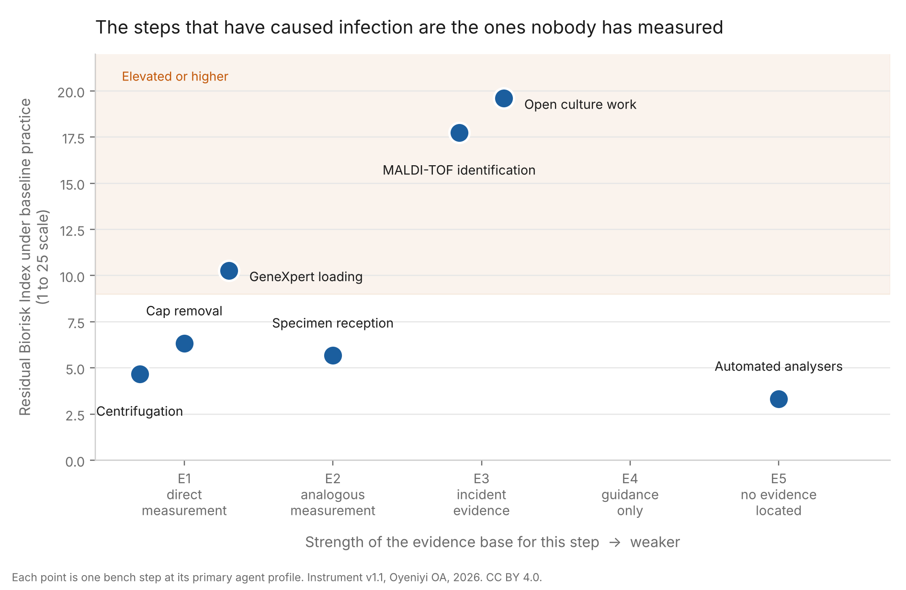
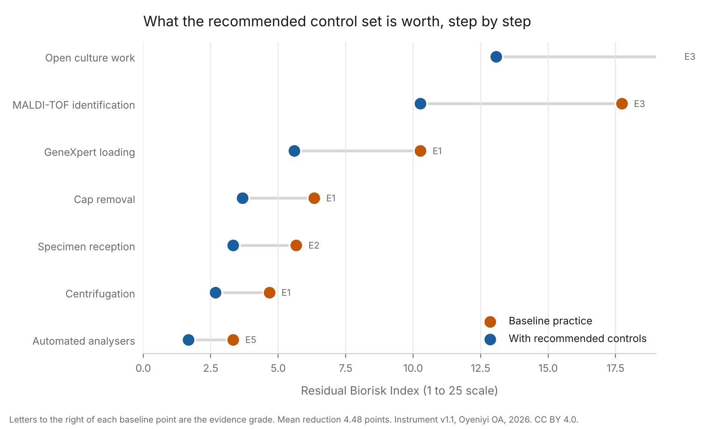

# Clinical Laboratory Aerosol Biorisk Reference

### A procedure-level BRACE scoring instrument for the bench steps of routine diagnostic testing, with reference scores, evidence grades and control sets

**Oyekunle Adedamola Oyeniyi (ORCID 0000-0002-1978-6133), Independent Researcher, Pullman, Washington, USA**

Instrument version 1.1 · Technical report

---

## Summary

Every clinical laboratory is required to assess the biorisk of its own procedures. Almost
none is given a method for doing it at the level of a single bench step. This reference
supplies one: an open scoring instrument of 12 anchored items across
three dimensions, mapped to the clause structure of ISO 35001:2019, applied to
7 routine bench steps under 3 agent profiles, with
78 recommended controls and 18 cited findings drawn
from 15 openly accessible sources.

The instrument's central design choice is that a score and its evidence grade are reported
together and never combined. Applying it produces a result that is uncomfortable and, I believe,
the most useful thing in this document: **the bench steps that laboratories worry
about most have been measured and found to release little, while the steps that have
actually infected and killed laboratory workers have never been measured at all.**

Of 7 steps, 3 carry direct quantitative aerosol measurement and
3 do not. The highest-throughput step in the laboratory, operation of automated
chemistry and haematology analysers, carries grade E5: no evidence located.

## Why this matters

CMS records 301,284 laboratories registered under CLIA as of
September 2026, of which 15,214 hold a certificate of
compliance and 15,542 a certificate of accreditation:
30,756 settings performing the moderate- and high-complexity
testing where these bench steps take place. National biosafety guidance asks each of them
to assess the risk of its own procedures and leaves the step-by-step work to each
laboratory. A shared, cited reference lets a frontline laboratory start from evidence
instead of a blank form.

## The instrument

Three scored dimensions and one reported grade.

- **Inherent Aerosol Release (IARS)**, 5 items, a property of the step before any control
  is credited: energy applied, containment of the specimen, volume and concentration,
  proximity to the breathing zone, and throughput.
- **Scenario Consequence (SCS)**, 3 items, a property of the organism rather than the step:
  inhalational infectivity, severity against the availability of prophylaxis, and the
  likelihood of unsuspected presence. The last of these is the one most often omitted from
  procedure risk assessments and the one the incident literature turns on.
- **Control Reliability (CRS)**, 4 items, scored twice for every step, once for baseline
  practice and once for the recommended control set: engineering effectiveness,
  independence from human performance, verification and certification, and PPE adequacy
  for the inhalation route.
- **Evidence Grade (E1 to E5)**, reported beside every score and never inside it.

Composition: `RBI = max(1, IARS - 0.8 x (CRS - 1)) x SCS`, on a 1 to 25
scale, banded Low, Moderate, Elevated, High, Very high. No control set is credited with
eliminating release, because the evidence base does not support that for any step here.

## Reference scores

At each step's primary agent profile. Full results for all 17 step and
profile combinations are in `data/processed/reference_scores.csv`.

| Bench step | Release (IARS) | Baseline RBI | With controls | Evidence |
|---|---|---|---|---|
| Open-tube and open-plate culture work | 4.6 | 19.6 (Very high) | 13.07 (Elevated) | E3 |
| MALDI-TOF target preparation and identification | 4.0 | 17.73 (High) | 10.27 (Elevated) | E3 |
| GeneXpert cartridge loading | 3.6 | 10.27 (Elevated) | 5.6 (Moderate) | E1 |
| Cap removal, decapping and aliquoting | 4.0 | 6.33 (Moderate) | 3.67 (Low) | E1 |
| Specimen reception and accessioning | 3.4 | 5.67 (Moderate) | 3.33 (Low) | E2 |
| Centrifugation of primary specimen tubes | 3.4 | 4.67 (Moderate) | 2.67 (Low) | E1 |
| Automated clinical chemistry and haematology analyser operation | 3.0 | 3.33 (Low) | 1.67 (Low) | E5 |





## What the evidence actually says

**Measured and negative.** Air and surface sampling during opening of blood sample tubes
and during centrifugation of capped primary tubes, in a working hospital biochemistry
laboratory using a model bacterium, recovered no organisms [DUBUIS2021]. These are the two
pre-analytical steps laboratories most often cite when asking for a cabinet. The one study
that measured them found nothing.

**Measured and conditional.** Viable aerosol production during cartridge loading and assay
running on the cartridge-based tuberculosis platform was reduced below that of acid-fast
smear preparation, provided the sample reagent was given its specified contact time; the
incorrect-use condition was deliberately simulated by omitting that incubation
[BANADA2010]. The safety case for this step rests entirely on a timer.

**Never measured, repeatedly lethal.** Almost all reported laboratory-acquired meningococcal
infections occurred in microbiologists who had manipulated sterile-site isolates on an open
bench rather than in a cabinet [MMWR2002MENING, SEJVAR2005]; in one fatal case the
investigation identified bench-top manipulation, open-bench plate spreading and flaming of
an incompletely dried slide among the breaches [MMWR2014CALAB]. No aerosol measurement of
routine subculture in a clinical laboratory has been located. This step carries the highest
score in the reference on grade E3.

**Not measured at all.** An investigation of exposure risk events across ten clinical
laboratories found rapid identification technology in use during several of the events, and
recommended handling slow-growing organisms in a cabinet and withholding automated
identification until biological threat agents are excluded [JCM2019BRUCELLA]. A review of
accidental laboratory aerosol generation identifies highly automated equipment as a source
still requiring characterisation [RAVNHOLDT2025]. No study has measured aerosol release from
a routine clinical chemistry or haematology analyser.

## Research priorities this reference identifies

1. **Measure a high-volume automated analyser.** Highest throughput in the laboratory,
   grade E5. One well designed measurement study would move this row from E5 to E1 and be
   citable by every laboratory in the country.
2. **Measure open-bench subculture and plate manipulation.** The step with the strongest
   incident evidence and no measurement.
3. **Measure the failure modes rather than the procedures.** For centrifugation and
   specimen reception the risk is concentrated in breakage and leakage, which is where
   measurement effort should go.
4. **Measure decontamination adequacy for instrument internal pathways** after a late-
   recognised isolate has passed through an automated platform.

## Limitations

See `docs/LIMITATIONS.md`, which is written in full and should be read before the scores
are used. In short: these scores are structured expert judgement, not measurement;
inter-rater agreement has not yet been measured; the control-credit weight and band cut
points are set rather than derived; and the literature search was targeted rather than
systematic.

## Reproducing this

```
python3 code/01_provenance.py
python3 code/02_build.py
python3 code/03_qa.py
python3 code/04_figures.py
python3 code/05_report.py
```

Every number in this document is interpolated from `report/stats.json`, which is written
by the build. The documents cannot disagree with the data.

## Licence

Instrument, data and documents CC BY 4.0. Code MIT.

## Sources

- **[ACKELSBERG2020]** Ackelsberg J, Liddicoat A, Burke T, Szymczak WA, Levi MH, Ostrowsky B, et al.. Brucella exposure risk events in 10 clinical laboratories, New York City, USA, 2015 to 2017. Journal of Clinical Microbiology. 2020. 58(2):e01096-19. doi:10.1128/jcm.01096-19. https://pmc.ncbi.nlm.nih.gov/articles/PMC6989065/ (accessed 2026-10-29)
- **[ASMBIOSAFETY]** American Society for Microbiology. Interim clinical laboratory guideline for biological safety. https://asm.org/guideline/interim-clinical-laboratory-guideline-for-biologic (accessed 2026-10-29)
- **[ASMSENTBRUC2025]** American Society for Microbiology. Sentinel level clinical laboratory guidelines for suspected agents of bioterrorism and emerging infectious diseases: Brucella species. 2025. https://asm.org/getmedia/ffb17144-8e7c-44b2-942d-9c4b8b557abf/brucella-guidelines_august2025.pdf (accessed 2026-10-29)
- **[ASMSENTINTRO]** American Society for Microbiology. Laboratory Response Network (LRN) sentinel level clinical laboratory protocols. https://asm.org/articles/cphmc/laboratory-response-network-lrn-sentinel-level-c (accessed 2026-10-29)
- **[BANADA2010]** Banada PP, Sivasubramani SK, Blakemore R, Boehme C, Perkins MD, Fennelly K, Alland D. Containment of bioaerosol infection risk by the Xpert MTB/RIF assay and its applicability to point-of-care settings. Journal of Clinical Microbiology. 2010. 48(10):3551-3557. doi:10.1128/jcm.01053-10. https://pmc.ncbi.nlm.nih.gov/articles/PMC2953088/ (accessed 2026-10-29)
- **[BMBL6]** US Centers for Disease Control and Prevention and National Institutes of Health. Biosafety in microbiological and biomedical laboratories, 6th edition. https://www.cdc.gov/labs/bmbl/index.html (accessed 2026-10-29)
- **[CMS2026]** Centers for Medicare & Medicaid Services, Division of Clinical Laboratory Improvement and Quality. CLIA laboratory statistics, September 2026. https://www.cms.gov/files/document/laboratory-statistics.pdf (accessed 2026-10-29)
- **[DUBUIS2021]** Dubuis M-E, Duchaine C. Aerosol production during blood and urine pre-analytical processing and handling in a hospital biochemistry clinical laboratory during the COVID-19 pandemic. Frontiers in Public Health. 2021. 9:643724. doi:10.3389/fpubh.2021.643724. https://www.ncbi.nlm.nih.gov/pmc/articles/PMC8097034/ (accessed 2026-10-29)
- **[LIU2023]** Liu Z, Lv J, Zhang Z, Ma J, Song Y, Wu M, Cao G, Guo J. Three experimental common high-risk procedures: emission characteristics identification and source intensity estimation in biosafety laboratory. International Journal of Environmental Research and Public Health. 2023. 20(5):4479. doi:10.3390/ijerph20054479. https://pmc.ncbi.nlm.nih.gov/articles/PMC10002466/ (accessed 2026-10-29)
- **[MMWR2002MENING]** Centers for Disease Control and Prevention. Laboratory-acquired meningococcal disease - United States, 2000. MMWR Morbidity and Mortality Weekly Report. 2002. 51(7):141-144. https://www.cdc.gov/mmwr/preview/mmwrhtml/mm5107a1.htm (accessed 2026-10-29)
- **[MMWR2014CALAB]** Sheets CD, Harriman K, Zipprich J, Louie JK, Probert WS, Horowitz M, Prudhomme JC, Gold D, Mayer L. Fatal meningococcal disease in a laboratory worker - California, 2012. MMWR Morbidity and Mortality Weekly Report. 2014. 63(35):770-772. https://www.cdc.gov/mmwr/preview/mmwrhtml/mm6335a2.htm (accessed 2026-10-29)
- **[RAVNHOLDT2025]** Ravnholdt AR, Ratnesar-Shumate SA, Santarpia JL. A review of accidental aerosol generation in laboratories and laboratory-associated infections. Applied Biosafety. 2025. 30(3):229-238. doi:10.1089/apb.2024.0014. https://www.ncbi.nlm.nih.gov/pmc/articles/PMC12415171/ (accessed 2026-10-29)
- **[SEJVAR2005]** Sejvar JJ, Johnson D, Popovic T, Miller JM, Downes F, Somsel P, Weyant R, Stephens DS, Perkins BA, Rosenstein NE. Assessing the risk of laboratory-acquired meningococcal disease. Journal of Clinical Microbiology. 2005. 43(9):4811-4814. doi:10.1128/jcm.43.9.4811-4814.2005. https://pmc.ncbi.nlm.nih.gov/articles/PMC1234112/ (accessed 2026-10-29)
- **[WHOLBM4]** World Health Organization. Laboratory biosafety manual, 4th edition. 2020. https://www.who.int/publications/i/item/9789240011311 (accessed 2026-10-29)
- **[WHOLBM4BSC]** World Health Organization. Laboratory biosafety manual, 4th edition: biological safety cabinets and other primary containment devices. 2020. https://www.who.int/publications/i/item/9789240011335 (accessed 2026-10-29)
